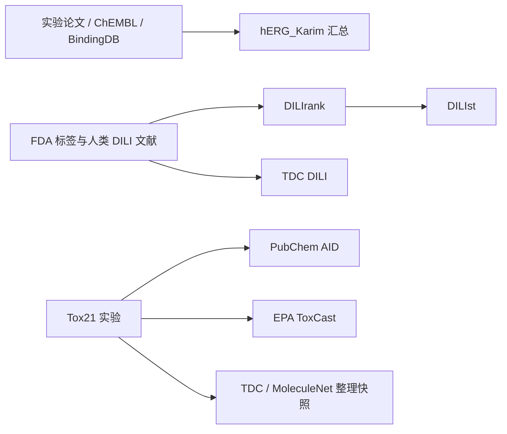

# 毒性数据集筛选与接入决策

核验日期：2026-10-12。目标是增加可审计的实验标签和结构覆盖，并建立可信的外部验证。数据门户、镜像和原始实验来源分别记录；换一个下载网站不会产生独立样本。本文的推荐角色是项目决策，网页数量是来源摘要，最终训练量必须以本地清洗和重叠审计为准。

**本轮已清洗 TDC hERG_Karim / Tox21，建立 9,978 条 hERG 回顾性外部来源评估池，并准备 Tox21 作为下一版独立通路任务。FDA DILIrank 2.0 / DILIst 已获取原始表，暂存为待映射候选。** 当前四端点训练集、冻结测试集和已训练权重保留原版本。候选数据没有加入当前 v2 模型训练或校准，没有依据本轮旧测试成绩调整种子或参数。hERG 评估池已通过结构与骨架交集筛除，但尚不能证明实验来源总体独立，也不是前瞻性数据。

## 候选比较

| 来源 | 端点及覆盖 | 本轮接入证据 | 推荐角色与限制 |
|---|---|---|---|
| 当前 TDC hERG / Ames / DILI / ClinTox | 四个现有输出端点 | 已有 9,814 条清洗后的结构—端点标签记录，详见 [DATA_SOURCES.md](DATA_SOURCES.md) | 保留已冻结的开发基线；ClinTox 测试仅 16 阳性，不能单独支撑广泛可靠性声明 |
| [TDC hERG_Karim](https://tdcommons.ai/single_pred_tasks/tox/#herg-karim-et-al) | hERG IC50 `<10 μM` 为阳性；实际 13,445 个 canonical 唯一结构 | 文件已下载并清洗；筛除旧集合交集及母体冲突 / 重复后留下 9,978 条 | 本轮用于冻结模型的回顾性外部来源评估；与原 hERG、ChEMBL、BindingDB、DeepHIT 和文献有来源交集，不能称为已验证来源独立的测试 |
| [Tox21 官方资源](https://tox21.gov/resources/) / TDC 快照 | 核受体与应激通路，12 个任务；原始 7,831 结构行 | 已清洗，保留 77,853 条结构—通路标签；9 个结构或母体标准化不可用的原始行对应 93 条标签隔离 | 下一版多任务训练候选，当前未入训。阳性表示相应实验通路活性，不能填入当前 hERG、DILI、Ames 或 ClinTox 标签列 |
| [EPA ToxCast](https://www.epa.gov/comptox-tools/exploring-toxcast-data) | 多来源体外生物活性及浓度反应，具体实验定义不同 | 当前官方版本 invitrodb v4.3；发布元信息已读取，未下载完整数据库 | 后续通路扩充与证据检索。先选少量有质量注释的实验；ToxCast 包含 Tox21 来源，不能把两者互作未经去重的独立测试 |
| [FDA DILIrank 2.0](https://www.fda.gov/science-research/liver-toxicity-knowledge-base-ltkb/drug-induced-liver-injury-rank-dilirank-20-dataset) | 人类 DILI 风险四类，1,336 药物 | XLSX 已下载；实际 217 Most、351 Less、414 No、354 Ambiguous | 优先作为 DILI 证据升级与外部验证候选。没有 SMILES，需要药物—结构映射；Ambiguous 保持未知。与原 FDA/TDC 来源重叠，未去重前不能称为独立验证 |
| [FDA DILIst](https://www.fda.gov/science-research/liver-toxicity-knowledge-base-ltkb/drug-induced-liver-injury-severity-and-toxicity-dilist-dataset) | 人类 DILI 二分类，1,279 药物 | XLSX 已下载；实际 768 阳性 / 511 阴性 | DILI 标签对照候选；由 DILIrank 和四份文献汇总而来，不能与 DILIrank 直接相加。也没有 SMILES |
| [MoleculeNet / DeepChem](https://deepchem.readthedocs.io/en/latest/api_reference/moleculenet.html) | Tox21、ToxCast、ClinTox 等整理后的任务与下载器 | 官方文档与加载代码可查；当前 ClinTox 已与其 CT_TOX 列核验 | 用于格式、标签和复现核验；多数相关任务是相同上游数据的整理版本，不是新外部数据库。FDA_APPROVED 与 CT_TOX 是不同列 |
| [ChEMBL](https://www.ebi.ac.uk/chembl/) | 文献来源、靶点、实验、测量值和关系符号 | 官方 API 可达，版本 ChEMBL_37（2026-05-01） | 后续按目标、实验类型与年代补充 hERG。必须保留 assay/document ID、IC50 单位及 `<`/`>` 等删失关系；不能把所有靶点结合或所有活性直接当毒性 |
| [PubChem BioAssay](https://pubchem.ncbi.nlm.nih.gov/pcfe/docs/markdown/pug-rest-tutorial.md) | AID 级实验描述、结果、CID/SID 与结构 | 官方程序接口文档可读，支持按 AID 下载；本轮未批量获取结果 | 支持 FDA 名称映射和选定实验取证。同一 Tox21 实验在 PubChem、EPA 和 TDC 的记录只算一个实验来源；无测量与 inconclusive 不当阴性 |
| [TDC LD50_Zhu](https://tdcommons.ai/benchmark/admet_group/19ld50/) | 大鼠口服急性 LD50 回归；页面记载 7,385 | 官方文件编号已核实，本轮未完整下载和清洗 | 可选独立回归任务，暂不加入现有四端点接口。输出单位为 `log(1/(mol/kg))`，不能标成 mg/kg、二分类概率或人体安全剂量 |

表中 TDC 任务摘要以[官方毒性任务页](https://tdcommons.ai/single_pred_tasks/tox/)为依据。LD50 的对数倒数变换另由[原始论文](https://pmc.ncbi.nlm.nih.gov/articles/PMC2796713/)确认：较大的变换值对应较小的原始致死剂量，不能沿用页面中含混的剂量方向描述。

## 已核验的下载与版本

TDC 文件编号来自固定提交 [e70285e5… / metadata.py](https://raw.githubusercontent.com/mims-harvard/TDC/e70285e5ace3bb1d72eb3c57bad2e73d750f5d42/tdc/metadata.py)。这些链接直接指向官方指定文件；没有使用随机数据镜像。

| 候选原始文件 | 官方下载入口 | 本轮状态 / SHA256 |
|---|---|---|
| hERG_Karim | [Harvard 6822246](https://dataverse.harvard.edu/api/access/datafile/6822246?format=original) | 已下载 885,072 bytes；`b47cbff0d65bbb5c6ade5ecd4c5bab20158c6cbf631a68f355efbe7e5fafc099` |
| Tox21 | [Harvard 4259612](https://dataverse.harvard.edu/api/access/datafile/4259612?format=original) | 已下载 681,007 bytes；`6e2bf5437e3016a77c850ad49a6112f9f00e61d3f62ade110cd99172c0bd53a1` |
| ToxCast 的 TDC 历史整理文件 | [Harvard 4259613](https://dataverse.harvard.edu/api/access/datafile/4259613?format=original) | 编号已核实，未完整下载；不能等同 EPA 2025 年 v4.3 |
| LD50_Zhu | [Harvard 4267146](https://dataverse.harvard.edu/api/access/datafile/4267146?format=original) | 编号已核实，未完整下载 |
| DILIrank FDA XLSX | [FDA 113052](https://www.fda.gov/media/113052/download?attachment) | 已下载 110,076 bytes；`1ca1352ff727af68e68e250eae2ed775bca8492335140ac0afd2233248694993` |
| DILIst FDA XLSX | [FDA 160597](https://www.fda.gov/media/160597/download?attachment) | 已下载 49,205 bytes；`4331ee9d16ae7641488161e4dc2c603c29e06baa8667dd16e7f3d635366e7e5e` |

Harvard 候选入口在本轮一次网络访问中返回 403，之后项目下载流程对 hERG_Karim、Tox21 成功获取原始文件。可下载状态以最终文件与哈希为依据；另外两个只确认入口编号，不承诺本机已获取。FDA 两文件位于 `data/candidates/raw/dilirank_fda.xlsx` 和 `dilist_fda.xlsx`；[fda-provenance.json](data/candidates/fda-provenance.json)记录来源、读取时间、文件哈希、表头、标签数量和尚未映射状态。

**FDA 表不能直接作为分子训练 CSV。** DILIrank XLSX 同时含 `version 2` 和 `version 1`，本轮只选 version 2 的 1,336 个药物，旧表不是额外的 1,036 个独立样本。新版新增 300 个 2010–2021 年批准的药物，并重分类了旧表中的 49 个药物；保留版本冲突，而非静默覆盖旧标签。两份文件只有药物名称等字段，没有 SMILES。需要把名称、盐型、前药、立体化学和生物制品分别审核；名称检索返回多个 CID 时，不能默认第一个结构正确。[FDA 新版说明](https://www.fda.gov/science-research/liver-toxicity-knowledge-base-ltkb/drug-induced-liver-injury-rank-dilirank-20-dataset)、[PubChem 名称检索说明](https://pubchem.ncbi.nlm.nih.gov/pcfe/docs/markdown/pug-rest-tutorial.md)。

## 本轮清洗与入库结果

以下数量来自实际文件和 [候选数据 manifest](data/candidates/processed/manifest.json)，候选版本为 `aidd-candidates-333b4f7d03532e15`。它与原训练数据版本分开保存，`currentModelTrainingUse=false`。

| hERG_Karim 处理阶段 | 条数 | 说明 |
|---|---:|---|
| 规范结构与有效原始标签 | 13,445 | canonical 唯一结构；6,718 阳性 / 6,727 阴性 |
| 排除全部旧 train / validation / test 的结构或骨架交集 | 11,910 | 按多层标识的并集排除 1,535 个结构；不把各层交集数相加 |
| 排除母体标签冲突 | 11,779 | 同母体异标签的 131 行全部隔离 |
| 折叠同标签母体重复 | 9,978 | 折叠 1,801 行；保留 4,886 阳性 / 5,092 阴性，5,429 个母体骨架 |

这里的母体审计标识为 RDKit 优先选择有机最大组分、去电荷、去立体标识，保留同位素；不合并互变异构体。交集审计同时使用完整 canonical 结构、上述母体以及完整 / 母体 Bemis–Murcko 骨架。无环结构保守地共用一个骨架组。它们用于保护评估，不改变分子输入或原始实验标签。

hERG 池文件为 [herg_external_pool.csv](data/candidates/processed/herg_external_pool.csv)，SHA256：`7e1df556c8674898e48b37c44f9bfdbcb9a4f60aba8df00dadff7564ce957262`。本轮确定其角色为 **冻结模型的回顾性外部来源评估池**；不是追加训练集，不用于选新权重、调参数或重新拟合校准。由于 hERG_Karim 汇总了部分相同数据库 / 文献总体，结构互斥不能证明来源总体独立；其 10 μM 阈值相对原训练 hERG 来源也可能有标签偏移。

该池的[冻结评估报告](artifacts/external-herg-evaluation.json)已完成：v2 模型 AUROC 0.6435、AP 0.6256；仅在原 train 拟合的 Morgan 逻辑回归基线分别为 0.6470、0.6430。v2 的 Brier 0.3349、ECE（10 箱）0.3116，说明这次来源 / 端点偏移下不能把概率当作已充分校准。未用该池更新模型、拟合校准或选择阈值；这组描述性结果没有显示神经模型超过基线，也不构成前瞻性或来源人群独立验证，尚无骨架聚类置信区间。

Tox21 实测有 7,831 个原始结构行，12 个任务合计 77,946 条已观测标签。隔离的 9 个原始结构行中，8 个无法通过严格解析，1 个含 Sb 的结构在母体中和后发生价态失败；这些行对应的 93 条观测标签已隔离。保留 **77,853 条结构—通路标签、7,822 个 canonical 唯一结构**。另有 16,026 个缺失任务单元保持掩码，未生成观测记录，也未当作阴性。这不是 77,853 个分子。具体每个任务的阳阴性、缺失量和清洗量在 manifest 中分别保存。

Tox21 和旧四端点集合的多层交集也已审计：7,822 个有效唯一结构中，6,430 个存在 canonical / 母体 / 骨架交集；完全无该交集的候选部分为 1,392 个结构、12,511 条任务标签。Tox21 当前角色是 **未来 12 通路模型候选数据**，并未完成新模型训练划分，也不能因为任务名称不同而忽略跨任务共享结构。FDA 两份数据则仍是 **待结构映射、待重叠审计的原始候选**。

## 来源重叠与合法使用

这里的箭头表示上游证据交集，不表示所有门户具有完全相同的分子或标签。hERG_Karim [原论文](https://doi.org/10.1186/s13321-021-00541-z)说明训练数据由多个数据库和文献整理，并另设外部测试。TDC 汇总文件的行数不能自动映射为原论文的训练 / 测试组；本轮必须核查每行来源与项目现有结构的交集。若无法恢复原分组，只能标记为汇总快照，不能声称重现作者独立测试结果。

| 数据来源 | 核验到的许可信息 | 项目处理 |
|---|---|---|
| TDC hERG_Karim / Tox21 / LD50 等 | 页面同时出现 `Not Specified` 和 CC BY 4.0 链接 | 保存原文字、作者与来源；未宣称全部底层实验具有统一商业再分发许可。软件许可不替代数据许可 |
| TDC ToxCast 整理快照 | 任务页标 CC BY 4.0 | 与 EPA 原始发布分别记录版本及许可，避免混用声明 |
| EPA invitrodb v4.3 | [Figshare 发布 API](https://api.figshare.com/v2/articles/6062623)实际返回 CC0；[官方发布页](https://epa.figshare.com/articles/dataset/ToxCast_Database_invitroDB_/6062623)关联具体版本 | 这是该发布包的元信息，未将其他外链资料一并认定为 CC0；导入时保存发布版本、具体文件和注释 |
| ChEMBL | [官方主页](https://www.ebi.ac.uk/chembl/)标 CC BY-SA 3.0 | 固定[数据库发布 DOI](https://chembl.gitbook.io/chembl-interface-documentation/downloads)并保留署名、变更及共享条款；培训页面的 CC BY 4.0 不是数据库许可 |
| FDA DILI 文件 | 页面公开下载，但未列出此文件的具体独立许可 | 保留官方表、作者、文献及文件级证据；不凭 `.gov` 域名推断所有第三方材料均无限制 |
| PubChem | [NCBI 使用政策](https://www.ncbi.nlm.nih.gov/home/about/policies/)说明提交来源可能主张知识产权，NCBI 无权转让全部权利 | 逐来源检查许可，记录 AID、提交者与实验协议；不把全库笼统称作 CC0 |

FDA 下载页面请求下载者联系支持邮箱。本项目记录该请求，未发送邮件。当前用途为本地研究候选审计，原始数据不随代码发布；后续数据或产品商业分发需依据实际数据条款处理。

## 接入前的固定验收条件

1. **确定标签合同。** 每个任务记录测量体系、物种 / 细胞、单位、浓度阈值、正类、关系符号、质量标记、原始记录 ID 与版本。hERG_Karim 的 10 μM 定义不自动覆盖旧 hERG 的来源标签；DILI 风险与体外通路活性保持独立。
2. **保存原始结构并分层查重。** 先严格 RDKit 解析、canonical isomeric SMILES；另做母体 / 盐、立体未指定和互变异构体重叠审计。这些审计标识用于发现潜在泄漏，不静默替换用户输入或合并不同实验对象。非法结构、未知标签、同端点冲突单列隔离；缺失值不补为 0。
3. **先确定候选角色再看成绩。** 新训练版在所有端点间统一按结构与骨架分组。旧测试结构及其审计近等价对象不能进入新增训练；另外报告同骨架的交集。外部验证需同时检查来源与结构独立性，仅换一个门户或删除精确重复不够。
4. **保留可比较的模型版本。** 新 CSV、来源 manifest、原始文件、split 和权重各自具有哈希。架构 / 训练预算 / 选择指标在验证前确定；训练只用 train，选择与概率校准只用 validation，测试一次性评价。当前模型与 Morgan 基线的旧结果继续保留，不将已有测试重新命名为未见测试。
5. **报告实际收益与不确定性。** 每端点给有效分子数、阳阴性、AUROC、PR-AUC、Brier、ECE、置信区间及基线对照。Tox21 / ToxCast 的大任务数不能替代独立分子数；适用域的相似度筛选仍是启发式。训练数据变大不会自行证明 Transformer 优于现有指纹模型。

## 继续项目的具体顺序

本轮 hERG_Karim 和 Tox21 的真实清洗、有效标签统计及与旧 train / validation / test 的交集报告已完成，固定 hERG 池上的 v2 模型与基线评估也已落盘。继续项目时优先改善已暴露的来源 / 标签分布偏移与概率可靠性问题；不使用该评估池选择新模型或校准。未来扩充训练需要另立版本和事先确定的开发 / 测试角色；已经读过评估成绩的池不能再次被宣称为全新的未见测试。Tox21 保持原 12 通路的任务名与缺失标签掩码，在扩展模型接口前，不向现有四端点填入这些通路标签。

随后为 FDA 候选建立可审计结构映射表，人工核实存在歧义的药物，并隔离生物制品 / 缺失结构 / Ambiguous。从尚未用于训练或选择、且与开发数据没有来源或结构泄漏的子集建立 DILI 外部验证。若无法证明独立性，明确标为来源交叉检查或标签更新，不能升级成独立外测。

EPA ToxCast 与 ChEMBL / PubChem 留作后续精选实验扩充：先固定少量明确相关端点和文件版本，再导入。LD50 进入独立回归合同后再训练，不改变当前四项分类概率的含义。
