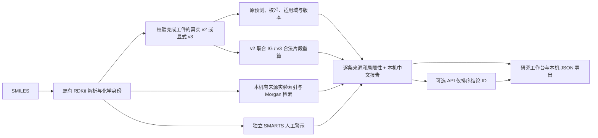

# 蓝研 ToxNet 可解释性与 AIDD 研究报告

本轮完成独立解释链路，不重新训练、部署或修改 v2/v3 模型。正式 v2 仍为 `aidd-toxnet-v2-5c22f6cc5dd3`，原 `/api/analyze` 的四端点结果、`drivers=[]` 和历史评价保持不变。工作台增加浅蓝色研究解释区；真实本机预测完成后，可选择归因端点、展开中文报告并单独下载 JSON。

## 架构与数据流程



预测、神经归因、人工规则、实验观察、机制假设和证据不足均独立标识。`confidence` 是证据措辞，不是另一个概率。数据集文献是来源背景，并非当前分子的已验证机制文献；`report.mechanismAssessment` 明确记录 `insufficient-evidence`、空 `verifiedMechanisticClaims` 及机制结论“不确定；尚无充分证据”。本轮没有接入分子特异机制实验库或自动文献检索。

## 归因方法与验证

v2 使用原子嵌入和实际 Morgan 输入联合 Integrated Gradients，目标是实际加载的校准 logit：`raw_logit / temperature + bias`。人工零嵌入/零指纹基线固定原分子的键、距离、CLS 和 mask。它不改变原 SMILES，但插值特征可能偏离训练分布，不是化学干预。图几何和 CLS 没有被归因，校准偏置在差分中消去。

Gauss–Legendre 积分默认比较 32/64 步，返回贡献守恒残差与 L1 收敛变化。数值检查失败时为 `computed-with-warning`；请求 128 步时没有更高步数对照，因此不标记收敛通过。最多解释 128 个原子，低于原模型预测的 200 原子预算。只对输入调用 `autograd.grad`，不累积参数梯度。

每个原子保留图分支和指纹分支贡献。Morgan 位分配到实际环境再分配到原子；碰撞、重复环境使分配不唯一。SMARTS 仅为官能团命名并汇总神经贡献，重叠片段不能相加。PNG 颜色表达带符号的指定端点 logit 贡献：红色提高、蓝色降低，不表示临床风险或安全。没有把注意力直接作为贡献。

v3 对显式加载且完整训练的多任务工件进行合法末端/BRICS 删除重算，最多八个变体。每次变体重新做 RDKit 价态和模型输入校验；返回原分数减变体分数，`atoms=[]`。合法变体也可能偏离分布，片段差异非加性贡献；图像仅高亮最大绝对差的删除片段。

发布前核对源码、权重、清单及实际模型版本；清单比较也保护校准状态。嵌入 forward 与原 forward 必须相等，归因前后原预测必须相等。任一 v3 重算快照改变会立即拒绝整次归因。模型、依赖或预算不可用时返回 `unavailable`，没有规则或模拟归因回退。

实际验证包含乙醇四端点及对乙酰氨基酚 DILI，共五项真实 v2 归因。乙醇 hERG 32/64 步残差为 `0.0018596617707671015`、L1 相对变化为 `0.017504490479725233`，嵌入与原 forward 最大差为 0。五项均通过本轮数值诊断；全部参数张量、参数梯度和原预测未改变。真实 B16 的 `tox21_nr_ar` 也完成两个合法变体重算。这些是解释软件的数值核验，不是归因机制正确性或模型效能的新证据。汇总见 [system-verification-final.json](artifacts/explanations/system-verification-final.json)。

## 实验索引和来源

复用现有固定来源、CT_TOX 原始标签重建、Tox21 缺失标签和候选重叠审计。显式准备索引时重建核验原始标签，加载及查询时核对原始/处理文件 SHA256、冻结成员和确切标签来源。修改观察并重新计算索引哈希仍不能绕过固定来源账本。

本机实测索引 `aidd-evidence-2c9dbc78fc913daa` 包含 24,847 个唯一结构、97,645 条已观测标签：原四端点 9,814 条、Tox21 77,853 条、已曝光 Karim 9,978 条。索引、来源分子行及完整报告没有提交到 GitHub。

按指定端点检索包含手性的 Morgan radius-2 / 2048-bit，默认 Tanimoto 至少 0.3，报告最多三条观察。输出规范结构/图片、来源数据库、真实二元标签、来源行或实验 ID、标签定义、文件版本/哈希和已有来源文献。当前来源不含统一剂量或完整 assay 条件，来源行 ID 不冒充已提供的实验 accession。

原 hERG 的阈值异质或未统一说明；Karim 的阻断阳性阈值为 `<10 μM`，不能默认同义。旧 validation/test 和 Karim 保留 `previously-exposed` 用途；观察只用于解释，不选择权重、不拟合校准、不形成新盲测。Tox21 保留十二个独立通路定义。

历史 v2 适用域指纹不启用手性，本轮检索启用手性，两者相似度与阈值分开解释。最大 Tanimoto 不能当预测置信度。乙醇 hERG 在默认阈值下没有匹配，正确返回证据不足；对乙酰氨基酚 DILI 的真实浏览器查询返回三个有来源的相似观察，不宣称它们是该查询分子的实验。缺文件、错哈希、错标签或无匹配一律空结果，不编造样本。

底层数据库的原始商业/再分发许可尚未完全解决，本模块限定本机研究展示并保留现有许可记录。不因软件许可证或数据公开下载就声称允许再分发。完整索引、分子标签和含实验观察的导出不得当成公开发布授权。

## Windows 11 PowerShell 运行

从项目根目录执行。可复用已安装的 `.venv-v3`；新环境安装基础、模型和测试依赖：

```powershell
python -m venv .venv-v3
$taskExplainPy = '.\.venv-v3\Scripts\python.exe'
& $taskExplainPy -m pip install -r requirements.txt -r requirements-model.txt -r requirements-dev.txt
# 只在需要 v3 时安装其额外依赖
& $taskExplainPy -m pip install -r requirements-v3.txt
& $taskExplainPy -m pip check
& $taskExplainPy -c "import torch; print(torch.__version__); print('CUDA:', torch.cuda.is_available())"
```

CPU 足以运行正式 v2 归因；本轮实测为 CPU，不需要 API 密钥。RTX 4060 8GB 的 v3 CUDA 配置与官方 CUDA wheel 检查沿用 [多任务文档](TOXNET_V3_MULTITASK.md)；本轮没有验证 CUDA。解释接口可返回显存不足/不可用，不用模拟结果掩盖失败。

若本机尚无原始与候选数据，先按固定来源准备；已有校验通过的缓存可加 `--offline`。缺文件或网络失败会明确报错，不构造真实数据替身：

```powershell
& $taskExplainPy scripts\prepare_toxicity_data.py
& $taskExplainPy scripts\prepare_candidate_data.py
# 指定新目录；已有目录会拒绝覆盖
& $taskExplainPy scripts\prepare_evidence_index.py --output data\evidence-index-new
$env:TOXNET_EVIDENCE_INDEX_DIR = (Resolve-Path 'data\evidence-index-new').Path
$env:OMP_NUM_THREADS = '6'
$env:MKL_NUM_THREADS = '6'
# 若 4173 已运行旧服务，先在其终端 Ctrl+C，再重启
& $taskExplainPy -m uvicorn backend.main:app --host 127.0.0.1 --port 4173
```

在页面选择真实模型和“蓝研 ToxNet · 自训练”，筛选后到报告下方点击“解释当前本机模型”。语言服务没有配置也可计算；实验索引没有准备时仍能获得真实预测/归因，并明确证据不足。输入、端点、供应商、模型配置修改或重置会使旧解释失效，正在运行的旧请求不能恢复旧报告。

离线索引包含本机源目录引用。迁移时一并保留全部已核验源缓存，并在新位置重新生成索引，不直接修改来源清单。国内网络下载失败时使用合法获取的固定来源原始文件，放入文档指定缓存后离线准备；不要用随机镜像文件替换哈希。MoLFormer 固定修订离线导入流程见 [预训练说明](TOXNET_V3_TRAINING.md#3-固定预训练权重与离线加载)。

CLI 输出拒绝覆盖既有文件：

```powershell
& $taskExplainPy scripts\explain_molecule.py --smiles 'CCO' --endpoint herg --steps 32 --output artifacts\explanation-local-new.json
# 可选语言供应商须先通过已有“配置 API”功能完整配置兼容对话端点
& $taskExplainPy scripts\explain_molecule.py --smiles 'CCO' --endpoint herg --include-language --language-provider qwen --output artifacts\explanation-language-new.json
```

v3 需要已有真实 B16 工件及核验通过的预训练缓存；它不通过工作台供应商自动部署：

```powershell
$env:TOXNET_MULTITASK_ENABLE = 'true'
$env:TOXNET_MULTITASK_MODEL_DIR = (Resolve-Path 'artifacts\v3-multitask\baselines-20261013\B16-seed-42').Path
$env:TOXNET_MULTITASK_ENCODER_DIR = (Resolve-Path 'models\pretrained\molformer').Path
$env:TOXNET_MULTITASK_DEVICE = 'cpu'
& $taskExplainPy scripts\explain_molecule.py --smiles 'CCO' --model v3 --endpoint tox21_nr_ar --output artifacts\explanation-v3-new.json
```

仓库不分发上述大型权重/本机研究工件，缺少时按多任务文档先训练，或只运行 v2。不要把未完成模型标为完成。

## API 与真实响应示例

完整字段和错误契约见 [MODEL_API_CONTRACT.md](MODEL_API_CONTRACT.md)。

```powershell
$taskExplainBody = @{ smiles='CCO'; model='v2'; endpoint='herg'; steps=32; includeLanguage=$false } | ConvertTo-Json
$taskExplainResult = Invoke-RestMethod 'http://127.0.0.1:4173/api/research/explain' -Method Post -ContentType 'application/json' -Body $taskExplainBody
$taskExplainResult | ConvertTo-Json -Depth 100 | Set-Content -Encoding utf8 'explanation-result-new.json'
```

以下为本轮真实 CPU 请求响应的选取字段，省略图像、完整来源及报告；这些分数是正式模型计算值，不是实验观察或人体风险：

```json
{
  "contractVersion": "aidd.research.explanation.api.v1",
  "status": "partial",
  "canonicalSmiles": "CCO",
  "structureId": "ab1de819ede91df490e6441934decfa9041b49f91d6bbadbba4df634ccff57fa",
  "modelPrediction": {
    "endpoints": [
      {"id":"herg","score":0.6148383021354675,"drivers":[]},
      {"id":"dili","score":0.29313886165618896,"drivers":[]},
      {"id":"ames","score":0.33746328949928284,"drivers":[]},
      {"id":"clintox","score":0.07335560023784637,"drivers":[]}
    ]
  },
  "attribution": {"status":"available","method":"joint-embedding-morgan-integrated-gradients"},
  "evidence": {"status":"insufficient-evidence","results":[]},
  "report": {"language":{"status":"not-requested","mode":"local-source-bounded-Chinese-rendering"}}
}
```

非法输入/未训练端点为 422，结构或权重与原报告不一致为 409，缺少真实模型/依赖为 503。可通过 `expectedWeightsSha256` 和 `expectedStructureId` 绑定原报告。归因或检索部分不可用时仍返回真实预测和逐项状态，不自动调用其它模型。

## 可选语言模型的受控范围

复用项目 `ModelConfig`、配置注册表和无重定向 HTTP 客户端，只接受完整配置的 `apiFormat=openai` 对话服务。外部请求仅含章节标题、结论 ID、来源种类和可信度措辞，不含分子、单条实验标签、来源行、文献或原始数据。密钥由服务端发送，不回显。

语言服务只能返回 `aidd.llm.report-plan.v1`，完整排序已存在章节和各章节内部结论。新增科学文本、分数、引用、遗漏、重复和跨章节结论都会拒绝。本机渲染保留原事实与局限性。这个阶段是来源受限的报告组织，不是开放式 LLM 机制推断。版本记录为配置/返回标识，未独立证明供应商不可变快照；硬件由供应商管理，账户使用条款适用。本轮未部署或声称审核过 TxGemma-Chat 权重。

## 实际测试、未运行项目与文件清单

本轮完整执行通过 **281 项 Python、52 项 JavaScript**，以及 `pip check`、两份前端语法检查。测试涵盖小型线性可解释模型贡献守恒、真实图 forward 对齐、指纹维度/位环境、合法与非法结构、来源/标签/哈希拒绝、模型快照变化、不可用路径、来源分类、LLM 本机 HTTP 传输夹具和错误响应、原四端点 HTTP 回归、重置/输入失效及导出。夹具明确标注为测试值，不计为真实科学实验。

实际 v2/v3 权重和索引验证、10 个 v2/历史工件未变化的 SHA256 记录见上述汇总。真实浏览器验证包括匹配与无匹配实验状态、PNG 归因、中文报告展开、语言服务未配置、本机 JSON 下载检查、输入修改禁用导出及运行中重置/旧响应失效。浏览器汇总见 [browser-verification.json](artifacts/explanations/browser-verification.json)，截图仅保存无实验行的乙醇视图。

```powershell
& $taskExplainPy -m unittest discover -s test -p 'test_*.py'
node --test test/*.test.js
node --check app.js
node --check toxicity-core.js
& $taskExplainPy -m pip check
# 此集成验证需要固定原始/候选缓存、证据索引和真实 B16 工件，缺少时不能视为通过
& $taskExplainPy scripts\verify_explanation_system.py --output artifacts\explanations\verification-new.json
```

尚未运行：付费外部 LLM 实调用（未选择/授权实际账户调用）、CUDA 归因（本环境使用 CPU wheel）、前瞻机制实验与临床认证（没有对应数据）。本轮无需新增训练；历史模型性能、负迁移结果均不改写。不宣称解释改善 AUROC 或筛选效能。

| 文件 | 作用 |
|---|---|
| `backend/attribution.py` | v2 联合 IG、v3 合法片段重算、诊断与结构热图 |
| `backend/evidence_search.py` | 离线固定来源索引、标签审计和端点相似检索 |
| `backend/explanation_report.py` | 来源分开的中文结论与受控 API 排序 |
| `backend/explanation_service.py`、`backend/explanation_routes.py` | 版本关联、组合报告与独立严格 HTTP 契约 |
| `backend/main.py` | 注册研究路由，保留原预测接口 |
| `scripts/prepare_evidence_index.py`、`scripts/explain_molecule.py`、`scripts/verify_explanation_system.py` | 离线准备、CLI、真实模型验证 |
| `index.html`、`app.js`、`styles.css`、`toxicity-core.js` | 研究面板、输入失效与导出、契约验证 |
| `test/test_attribution.py`、`test/test_evidence_search.py`、`test/test_explanation_report.py` | 归因、索引、报告和 API 单元验证 |
| `test/explanation-core.test.js`、`test/ui-state.test.js`、`test/explanation_browser_app.py` | 客户端/状态回归和不读取 API 密钥的真实权重 QA 服务 |
| `README.md`、`MODEL_CARD.md`、`MODEL_API_CONTRACT.md`、本说明 | 用法、科学边界与契约 |
| `.gitignore`、`.gitattributes`、`artifacts/explanations/` 汇总 JSON | 禁止数据/缓存再分发、保留汇总字节与验证证据 |

后续机制模块应在 `build_report` 前插入独立、来源审核的证据适配器，每条增加 DOI/PMID 或实验标识、查询结构对应关系、证据类型、版本和局限性。Tox21 的衔接使用 `MultitaskModelClient.predict_all` 的已训练任务与 `TOX21_ENDPOINTS` 标签合同，通路活性只作为实验/模型通路证据，不能直接改写四端点标签或合成临床概率。
