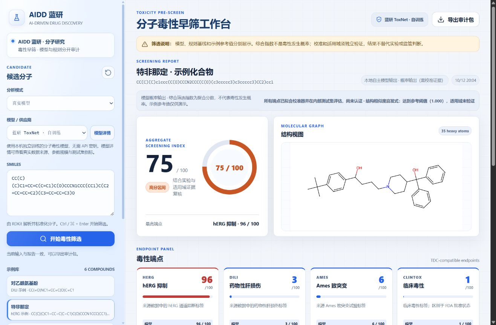

# AIDD 蓝研



界面采用浅蓝侧栏，支持按钮悬停与按压反馈、报告渐入、风险条与圆环展开、弹窗开合动画。手机布局和滚动已适配，系统开启“减少动态效果”时会减少动画并使用即时滚动。

本仓库保存项目源码、已训练模型权重、冻结划分、实测评估及页面截图。克隆后安装下列依赖即可使用本机模型；API 密钥需要在自己的本机配置。原始公开数据和候选数据缓存通过准备脚本按固定来源与 SHA256 重新获取。

分子毒性筛选工作台：RDKit 负责可靠的分子处理，Python 服务支持本机自主模型及外部模型 API，浏览器展示模型、规则基线和演示参考值的独立结果。

支持配置 OpenAI / ChatGPT、DeepSeek、千问、GLM，以及遵守明确契约的自定义预测服务。支持为具备视觉能力的具体模型附带 RDKit 生成的分子结构图。模型密钥只在服务端使用。

新增 **蓝研 ToxNet**：已完成从随机权重训练的分子 Transformer，实际参数量 **2,374,390**，模型版本 `aidd-toxnet-v2-5c22f6cc5dd3`，通过真实 TDC 标签学习 hERG、DILI、Ames、ClinTox 四个端点。它在本机运行，不需要第三方 API 密钥。架构、权重校验值、训练记录及实测指标见 [MODEL_CARD.md](MODEL_CARD.md)，数据来源见 [DATA_SOURCES.md](DATA_SOURCES.md)。它是适合本机运行的小型分子模型，没有使用 TxGemma 权重。

**v3 独立研究链路**已接入固定修订的真实 MoLFormer 冻结表征，完成同一隔离开发划分上的 B0 指纹 LR、B1 embedding LR、B2 embedding MLP 三种子实验。没有覆盖 v2 或切换网站供应商；开发 validation 用于选择，不能当新盲测或据此宣称泛化提升。架构与数据协议见 [TOXNET_V3_PLAN.md](TOXNET_V3_PLAN.md)，Windows/离线复现见 [TOXNET_V3_TRAINING.md](TOXNET_V3_TRAINING.md)，真实完整指标及未运行项目见 [TOXNET_V3_EVALUATION.md](TOXNET_V3_EVALUATION.md)。预训练大权重、完整本机研究工件、缓存与原始/派生分子标签不提交；仓库保存审核源、许可和不含分子行的汇总证据。

本轮冻结骨架 test 集的 AUROC 为 hERG **0.7359**、DILI **0.7640**、Ames **0.7759**、ClinTox **0.7426**。四个端点的指纹逻辑回归基线 AUROC 均更高；ClinTox test 仅 16 个阳性。另已完成 hERG 外部来源回顾性评价：9,978 个审计分子上的 AUROC **0.6435**、AP **0.6256**、Brier **0.3349**、ECE **0.3116**，概率误差较大。**当前模型是研究原型，尚不能支持可靠筛选结论**；未证明优于简单基线，来源人群独立性、前瞻验证和临床效能认证仍未建立。

## 启动

需要 Python 3.13 或具有相应依赖 wheel 的兼容 Python 版本。当前环境已建立 `.venv` 并安装依赖。

```powershell
python -m venv .venv
.\.venv\Scripts\python.exe -m pip install -r requirements.txt
.\.venv\Scripts\python.exe -m pip install -r requirements-model.txt
.\.venv\Scripts\python.exe -m uvicorn backend.main:app --host 127.0.0.1 --port 4173
```

访问 http://127.0.0.1:4173。也可以运行 `npm run serve`。工作台需要 Python 后台，不能通过双击 HTML 或普通静态服务器完成分析。`requirements-model.txt` 为本机训练与推理依赖；仅使用外部 API 或规则模式时可以不安装。未找到完整本机模型工件或依赖时，页面会显示不可用状态，不用演示分数替代训练结果。

## 使用自主模型

1. 将分析模式设为“真实模型”，选择 **蓝研 ToxNet · 自训练**。
2. 输入 SMILES，点击“开始毒性筛选”。本机 CPU 返回四端点的神经网络预测，不需要配置 API。
3. 点击供应商旁的“模型详情”，查看真实数据来源、样本数、留出性能、模型版本及限制。
4. 分别查看模型概率输出、规则基线和示例参考。完成本机 v2 筛选后，可在下方“研究性解释”面板选择端点并生成真实模型归因、实验检索和中文报告；结构警示仍属于独立人工规则，归因不能验证毒性机制。
5. 导出审计包留存来源和版本。输入、模式或模型改变后需重新筛选。

自主模型工件位于 `models/aidd-toxnet/`。`GET /api/local-model/info` 返回模型信息和留出评估，权重与训练参考结构不通过此接口公开。页面显示的概率是训练数据标签预测，不能直接理解为人体发生毒性的概率。校准状态为“已测量，未认证”，结构相似度只作启发式提示。

“模型详情”现已同时展示 hERG 外部来源回顾性评价及指纹基线，注明来源与标签变化、独立性尚未确认、概率误差较大。后台只把与当前模型版本、权重及清单哈希完全匹配、未改权重/校准/阈值且指标合法的附录放入 `externalEvaluation`，避免把其他模型或无效记录的成绩展示为本模型结果。

## 研究性解释与中文报告

独立 `POST /api/research/explain` 复用实际加载模型，不改变 `/api/analyze` 的四端点预测、校准或历史工件。v2 对原子嵌入和 Morgan 分支联合计算 Integrated Gradients，输出端点级原子热图及片段汇总，附基线、完整性与数值收敛诊断；v3 多任务研究模型使用合法片段删除后的真实重算，输出响应差而非加性原子贡献。归因失败时明确返回 `unavailable`，不以规则或注意力替代。

实验检索使用本机已审计数据的 Morgan/Tanimoto 相似度，显示规范结构、真实来源标签、任务定义、行标识、版本和 SHA256。默认只展示所选端点的最多三条记录。索引需要显式准备，不随源码分发；原始数据缺失、哈希核验失败或没有匹配时显示“证据不足”。旧 validation/test 与 hERG_Karim 记录保留已曝光标记，仅用于解释参考，不用于新模型选择。hERG_Karim 的 `<10 μM` 定义不等同于原 hERG 的异质阈值，最大 Tanimoto 也不是预测置信度。

```powershell
# 先完成原始数据和候选数据准备；已有索引时请选择新的输出目录
.\.venv\Scripts\python.exe scripts/prepare_evidence_index.py --output data/evidence-index
.\.venv\Scripts\python.exe scripts/explain_molecule.py --smiles 'CCO' --endpoint herg --output artifacts/explanation-local.json
```

默认读取 `data/evidence-index`，可在启动前设置 `$env:TOXNET_EVIDENCE_INDEX_DIR` 指向另一个通过审计的本机索引。没有索引或外部语言模型时仍保留真实本机预测与可运行的归因；不会改用演示分数。现有索引已经存在时，准备脚本拒绝覆盖；索引保存绝对来源路径，移动到其他电脑后应从该电脑的已核验来源重新准备。

中文报告逐条区分模型计算、人工规则、实验观察、机制假设和证据缺失，提供来源、可信度措辞及局限。可选外部语言模型复用“配置 API”，本阶段只接受兼容对话接口返回的封闭结论排序计划；科学文本与数字由本机固定渲染，外部模型不能新增事实、改写分数或生成文献。请求不含分子结构、实验行或原始训练数据；未配置、超时或响应不合法时保留完整本机报告。供应商版本按配置及返回标识记录，未独立证明为不可变快照，也未部署 TxGemma-Chat。

页面保留浅蓝色布局、原有模型选择和密钥机制，新增可展开报告、原子图与独立 JSON 导出。修改输入、切换模型或重置后，旧解释与导出立即失效。网页入口目前面向已完成的本机 v2 报告；v3 归因需显式启用完整研究工件后通过研究 API 或命令行调用。

方法、完整 PowerShell 复现命令及科学限制见 [EXPLANATION_REPORTS.md](EXPLANATION_REPORTS.md)，接口字段和错误见 [MODEL_API_CONTRACT.md](MODEL_API_CONTRACT.md)。这些报告属于研究原型，不构成临床诊断或人体风险概率；尚无经核验的分子特异机制文献检索，结构归因与语言整理都不能作为科学机制验证。

## 准备数据与重新训练

```powershell
.\.venv\Scripts\python.exe scripts/prepare_toxicity_data.py
.\.venv\Scripts\python.exe scripts/train_toxnet.py --seed 42 --device cpu --threads 6 --epochs 30 --patience 7 --batch-size 48 --output models/aidd-toxnet-new
```

已下载原始数据时，可在准备命令末尾加 `--offline`。脚本核对固定 SHA256、规范结构、删除重复并隔离冲突；不补猜缺失标签。重新训练使用新的输出目录，保留已有完整模型。运行新模型时，在启动前设置 `$env:AIDD_LOCAL_MODEL_DIR = "模型目录的绝对路径"`，再启动后台。完成工件包括 `manifest.json`、`weights.pt`、`evaluation.json` 和训练参考集合，服务会检查校验值及完成状态。

固定 seed=42 的骨架划分同时约束所有端点的结构与骨架。优化仅使用 train，检查点选择与温度/偏置调整仅使用 validation，最后评估 test。测试集不得用于调参或挑选种子。许可及小样本限制见数据说明和模型说明。

现有模型使用 9,814 条结构—端点标签记录，对应 9,428 个不同分子；train / validation / test 的标签记录数为 7,851 / 982 / 981，不同分子数为 7,535 / 956 / 937。CPU 训练实际 10 轮，validation 选择第 3 轮权重；记录的训练及评估阶段耗时 231.9 秒。通过 `scripts/verify_local_model.py` 可重新验证真实权重 HTTP 推理及五组等价 SMILES；默认检查已有本机模型，不调用外部供应商。

新增数据的可用性、端点匹配、许可与重叠风险筛选见 [DATASET_SELECTION.md](DATASET_SELECTION.md)。已使用的 TDC 四端点数据与待接入候选分别记录；候选数据不会自动加入现有模型，也不能未经重叠核验就称为独立外部测试。

候选接入脚本读取固定 TDC metadata 与官方 hERG_Karim、Tox21 文件，写入单独的 `data/candidates/` 目录，对冻结的全部 train / validation / test 做精确结构、母体及骨架交集审计：

```powershell
.\.venv\Scripts\python.exe scripts/prepare_candidate_data.py
# 原始文件已下载并通过校验时可使用 --offline
```

输出包括 `processed/manifest.json`、各来源的规范标签 CSV、隔离与重复记录、重叠审计，以及经过排除的 `herg_external_pool.csv`。hERG 候选池仅用于另行冻结的回溯来源评估，不声明来源人群独立；Tox21 维持 12 个独立实验任务，缺失标签不填 0，不能直接冒充四项现有标签。脚本不改现有权重、校准或划分。FDA DILI 候选仍需先完成药物名称到结构的审核映射，具体状态以筛选记录为准。

实际 hERG 外部来源评估记录为 `artifacts/external-herg-evaluation.json`：9,978 分子，4,886 阳性 / 5,092 阴性；重新核验与全部旧集合的结构、母体和两层骨架分离。原 train 指纹基线 AUROC 0.647018、AP 0.642957、Brier 0.346826、ECE 0.314246；v2 模型的对应值为 0.643476、0.625562、0.334936、0.311605。本轮没有改权重、校准或阈值。hERG_Karim 使用 `<10 μM` 阳性阈值，旧 hERG 没有统一匹配阈值，存在标签与来源变化，不能用内部/外部 AUROC 差异推断单一泛化原因。

```powershell
# 指定新输出以保留既有评价；默认路径已有记录时脚本拒绝覆盖
.\.venv\Scripts\python.exe scripts/evaluate_external_herg.py --output artifacts/external-herg-recheck.json
```

## 配置真实模型

页面中选择模型供应商后，点击旁边的 **配置 API** 按钮。填写完整推理接口地址、模型名称、实际版本及 API 密钥，点击保存后立即生效，无需重启。默认接口地址自动填入；高级设置可选择接口格式、超时、图片输入和对话参数。

配置由本机后台写入 `.env`，密钥不会被读回浏览器或存入浏览器存储。再次打开时，密钥栏留空表示保持现有密钥；输入新值可替换。配置是否保存成功与供应商能否实际推理分别判断。修改模型配置会暂停旧模型报告的导出，需要重新筛选。

也可复制 `.env.example` 为 `.env` 后手动填写并重启。已有系统环境变量在启动时优先于 `.env`；网页保存会立即覆盖本次运行的配置，但系统环境变量仍会在重启时优先，弹窗会提示这一情况。`.env` 已加入 Git 忽略。

例如使用千问时填写：

```dotenv
TOXILENS_DEFAULT_PROVIDER=qwen
TOXILENS_QWEN_API_KEY=在本地填写真实密钥
TOXILENS_QWEN_MODEL_NAME=账户可用的实际API模型标识
TOXILENS_QWEN_MODEL_VERSION=实际模型快照或修订版本
TOXILENS_QWEN_SEND_IMAGE=false
```

OpenAI、DeepSeek、GLM 对应前缀为 `TOXILENS_OPENAI_`、`TOXILENS_DEEPSEEK_`、`TOXILENS_GLM_`。使用支持图片的具体模型时才设置 `SEND_IMAGE=true`。可通过 `API_URL` 覆盖供应商地区或接口地址。网页供应商下拉框可切换已配置模型。

自定义模型使用 `TOXILENS_CUSTOM_` 前缀，`API_FORMAT=json` 接入专用预测服务，`API_FORMAT=openai` 接入兼容对话接口。自定义 JSON 服务的请求、响应和分数类型见 [MODEL_API_CONTRACT.md](MODEL_API_CONTRACT.md)。如果 API 参数不兼容，应用会报错，需按供应商要求调整适配器；不会静默换模型或编造结果。

健康检查显示“已配置”仅表示配置完整，不保证供应商可达、密钥有效或模型权限可用。**外部供应商实际调用验收未作为本轮证据**；适配器链路由明确标注的本地 HTTP 模拟服务验证，自主模型则由真实训练权重独立核验。用户本机的凭据不属于文档公开内容。OpenAI API 使用独立的 API 账户和计费，不调用 ChatGPT 网页订阅。

## 两种分析模式

- **真实模型**：默认模式。选择蓝研 ToxNet 时在本机运行实际训练权重；选择外部供应商时通过后台发起 HTTP API 调用。缺少本机工件、未配置 API、超时或响应无效时明确报错。
- **规则基线**：由用户主动选择，使用 RDKit 描述符和十类 SMARTS 警示，独立计算未校准的演示规则分数。

预设化合物的固定分数只在“示例参考”栏显示，注明是未核验真实标签来源的演示数据，不参与模型或规则结果。

通用对话模型的分数统一视为探索性的未校准分数，不能因通过 API 调用就当作已验证的分子毒性预测。自主模型有实际训练、内部留出及 hERG 外部来源回顾性评价；外部来源上校准误差较大，独立来源人群和前瞻能力仍未证实。综合指数是聚合分数，不是毒性发生概率。外部模型缺少校准和适用域证据时为未知。

## 日常使用

1. 打开 `http://127.0.0.1:4173/`，将分析模式设为“真实模型”，选择供应商。
2. 点击“配置 API”。默认推理接口地址已填入；模型名称使用供应商控制台中账户可调用的 API 标识，版本填写实际快照或如实记录当前别名，密钥在页面中填写。点击“保存配置”后立即生效。
3. 关闭弹窗，输入一个分子的 SMILES。例如乙醇为 `CCO`；也可直接点击示例库。模型支持视觉输入时，可在高级设置启用分子结构图。
4. 点击“开始毒性筛选”，查看 hERG、DILI、Ames、ClinTox 四端点，分别核对模型分数、规则基线、示例参考及解释来源。
5. 输入与当前报告一致时，点击“导出审计包”，保存分子、结果和来源版本。修改输入、模型供应商或 API 配置后需重新筛选。

没有 API 密钥时，可直接选择已有训练工件的“蓝研 ToxNet · 自训练”；也可以主动选择“规则基线”体验分子解析。其他自行训练的模型仍可部署为自定义 JSON 预测服务，按 `MODEL_API_CONTRACT.md` 接入。

## 已完善的可靠性

- 严格 SMILES 解析、化学价态校验和 canonical isomeric SMILES；保留立体信息、同位素和盐片段，去除原子映射注释。
- RDKit 分子量、氢键供受体、TPSA、cLogP、环数和可旋转键计算；不再使用手写隐式氢解析。
- 十类警示采用 SMARTS 子结构匹配，覆盖阳性、阴性及等价表示回归。
- 正确的 RDKit 二维结构图，包含三键、芳香结构与带电原子。
- 请求版本和 AbortController 防止重置后旧报告恢复；修改输入、模式或模型后暂停导出，要求重新筛选。
- JSON 审计包记录结构标识、模型/规则/参考分数、解释来源、请求标识、模型/提示词/化学引擎/规则版本及校准和适用域状态。

结构规范化保持原输入的盐形式、质子化状态和互变异构体，不把这些化学差异自动合并；跨版本 RDKit 的结构标识应结合引擎版本解释。

## 测试

```powershell
.\.venv\Scripts\python.exe -m pip install -r requirements-dev.txt
.\.venv\Scripts\python.exe -m unittest discover -s test -p test_*.py -v
node --test test/*.test.js
```

测试覆盖化学回归、十种警示、实际本地 HTTP 模型适配、异常响应、供应商选择、API 契约、前端取消/重置/输入修改、审计来源、真实数据预处理及本机训练工件加载。新增 Transformer 验证覆盖实际梯度更新、padding 隔离、等价 SMILES、同位素编码、validation 校准与缺失标签屏蔽。实际模型性能以完整训练输出的留出评估为准，不能用测试夹具指标代替。

原 v2 交付完整运行通过 **101 项 Python 测试、41 项 JavaScript 测试**，并通过依赖及前端语法检查、真实权重的五组等价表示 HTTP 集成。本次解释系统完整运行通过 **281 项 Python 测试、52 项 JavaScript 测试**，覆盖来源与权重关联、归因数值检查、索引标签完整性、外部语言模型失败、严格报告排序契约及解释重置/失效/导出。实际验证还使用正式 v2 权重完成五项归因（两个分子），并验证真实 v3 多任务权重，核对归因前后预测与参数未改变；汇总见 `artifacts/explanations/system-verification-final.json`。本轮未进行付费外部语言模型实调用或 GPU 验证。测试通过验证软件行为，不证明模型具有可靠毒性效能。

浏览器集成测试可单独启动明确标注的模拟模型服务：

```powershell
.\.venv\Scripts\python.exe -m test.browser_fixture
```

访问 http://127.0.0.1:4174。该端口仅是测试夹具，使用固定值和延迟验证取消及失败路径，不是实际模型推理；正常工作台仍在 4173。

## 真实模型研究验证

已接入真实 TDC 标签并完成本机分子 Transformer 训练。提供骨架划分、留出评估、Brier/ECE、内部 bootstrap 区间、简单基线比较和实际训练参考集合相似度，并已对冻结模型完成 hERG 外部来源回顾性评价，说明见 [RESEARCH_VALIDATION.md](RESEARCH_VALIDATION.md)。完成状态、模型修订、真实指标与边界以 [MODEL_CARD.md](MODEL_CARD.md)、校验通过的模型工件及独立外部评价记录为准。外部 API 实调用验收未作为本轮证据；来源人群独立性、前瞻评估及有效适用域验证仍未建立。

真实浏览器已验证本机模型选择、模型详情、输入修改状态、请求中重置、重新生成报告、三键及实际 JSON 导出；最后刷新后确认外部评价显示 9,978 分子、模型与基线对照及来源/研究限制。截图为 `artifacts/aidd-toxnet-workbench.jpg`、`artifacts/aidd-toxnet-details.jpg`、`artifacts/aidd-toxnet-external-evaluation.jpg`，审计导出为 `artifacts/local-model-browser-audit.json`；它们验证产品交互和版本链路，不能替代模型效能评估。

文件 `项目审查分析.md` 保留 v1 的审查记录，反映修复前的问题；本轮实现和实测结果见 `完善与验证记录.md`。

## v3 多任务研究扩展

四毒性端点与十二个 Tox21 通路采用独立标签、共享结构分组和缺失掩码，沿用固定修订的冻结 MoLFormer 表征。新增 A4、B16、Morgan 对照及零通路损失消融，默认不替换正式 v2。独立 `/api/research/tox21` 只返回十二通路活动分数，没有完整已训练工件和显式研究启用时返回不可用。

数据隔离、真实实验结果、负迁移分析、Windows 训练及离线服务命令见 [TOXNET_V3_MULTITASK.md](TOXNET_V3_MULTITASK.md)。原四任务 v3 历史成绩保留；本轮同划分比较使用重新训练的对照，不称新盲测。

## 三轮整合与 CUDA 验收

三轮代码在独立 `codex/toxnet-integration-cuda` 分支审查，正式 v2 工件与历史评价保持原字节。新增真实运行验收和 CUDA 工具，加固 v3 禁入来源重建、化学引擎/评价合同与历史源码核验，并区分 GPU 特征提取和 CPU 逻辑回归训练。Windows 安装、实际显存与实验记录见 [CUDA_VALIDATION.md](CUDA_VALIDATION.md)，PR 顺序、squash 注意事项、接口兼容及科学边界见 [TOXNET_V3_INTEGRATION.md](TOXNET_V3_INTEGRATION.md)。代码整合不自动合并 main 或发布 v3。

## 四轮正式代码整合

2026-10-13 获得用户明确授权后，PR #1–#4 已依次通过普通 merge commit 合入 main，原分支和历史训练源码保留。main 源码重新通过 CPU/CUDA 环境各 326 项 Python 测试、52 项 JavaScript 测试及真实模型接口验收；v2 正式工件保持不变，v3 仍为研究模型。实际合并 SHA、验收证据、新电脑运行条件及后续边界见 [MAIN_INTEGRATION_ACCEPTANCE.md](MAIN_INTEGRATION_ACCEPTANCE.md)。没有 GitHub Actions 成功记录，不把本机测试写成 CI 通过。
## 四模型研究 Compare 工作台

新增 `/compare`：真实 ToxNet v3 B16 主预测、审核合同下的 TxGemma 专项预测、本机 Ollama Qwen 主报告，以及逐次授权的 DeepSeek 独立报告。浅蓝色独立页面连接异步 FastAPI，支持四卡状态、4+12任务表、双栏报告、来源核验、真实性能、取消、预设与JSON导出；输入或配置变化使旧结果失效。

初版Compare已记录真实CUDA B16及旧v2 HTTP验收；其余三项适配器的软件测试不代表真实部署。后续P0/P1加固取消/清理、脱敏诊断、真实usage保留、本机历史和交互恢复：不变报告保留原DOM、详情和焦点，实验检索与归因可独立启用，预设支持创建/更新/重命名/删除，当前Qwen选择和DeepSeek访问待核验分别展示。

历史默认只在本机SQLite schema2保存脱敏摘要；完整SMILES、研究问题、检索观察和报告全文需逐次勾选 `persistSensitiveContent=true`。预设不保存云端授权，历史只保留原运行的授权/请求审计标记，不复用执行许可。浏览器仅记住runId，历史打开和刷新不重跑模型。Windows OneDrive目录默认把数据库放到非同步的LocalAppData；资源清理未确认时持久隔离，普通重启不解锁。当前实现仅支持同一库的单进程/单worker，无法调度外部GPU应用。维护恢复命令及API详情见 [AIDD_COMPARE_WORKBENCH.md](AIDD_COMPARE_WORKBENCH.md) 和 [MODEL_API_CONTRACT.md](MODEL_API_CONTRACT.md)。

本次P0/P1最终测试、Linux CI与真实模型复验状态以新增验收记录为准，未在这里预先填写通过数量或部署结论。Ollama、TxGemma、DeepSeek哪些已安装/授权/真正执行，需要分别验收；未报告费用为unknown，不能当作零费用。模型不投票、不平均、不排名，v3始终 `formalAvailability=false`。

2026-10-14 本机已真实完成 B16 → Ollama TxGemma BBB_Martins → Qwen3.5:4b 的研究流程，DeepSeek未调用。新增量化来源校验与报告生成预算配置；TxGemma量化发布者未公开官方上游修订，不能冒充已审核的官方权重版本。最新验收、后端重新加载状态及Windows命令见 [OLLAMA_DEPLOYMENT_ACCEPTANCE.md](OLLAMA_DEPLOYMENT_ACCEPTANCE.md)。

### Compare 轻量报告与透明计量

新增严格 `aidd.compare.report.v2`：Qwen/DeepSeek只排列事实ID和章节并提供有界中文解释，所有真实分数、专项类别、结构、来源与版本由后端不可变快照重建。生成解释始终unverified，不改毒性预测或科学结论。新前端显式使用v2并提供Fast/Deep切换；旧API省略新字段仍默认v1/deep，历史记录可继续查看。Fast和Deep均保留全部请求事实和科研限制，减少重复生成只是工程设计，是否更快以实际同条件基准为准。

中文问题通过本机确定性术语映射，支持四端点、BBB和Tox21主题；歧义或未支持任务明确提示，BBB仍需自己选择已审核专项任务，不自动定义实验标签。`GET /api/research/compare/runtime` 提供启动源码SHA和Compare资源状态，历史增加仅元数据的 `q` 搜索；SQLite继续schema2，不回填或重写旧报告。可选 `TOXNET_COMPARE_GPU_SAMPLING=true` 记录每阶段整卡采样占用，不能等同PyTorch分配或单模型精确显存峰值。

完整合同、字符预算和Windows启动/恢复流程见 [COMPARE_REPORT_OPTIMIZATION.md](COMPARE_REPORT_OPTIMIZATION.md)，方法和真实计量见 [COMPARE_PERFORMANCE_BENCHMARK.md](COMPARE_PERFORMANCE_BENCHMARK.md)。新验收使用独立 `artifacts/compare/report-optimization-20261014/receipt.json`，不覆盖历史记录；没有实际成功回执的模型执行、Token、耗时和提速仍待验证。正式v2、B16权重与历史评估不变，全部v3继续研究用途；DeepSeek未经新授权不进行收费API调用。
