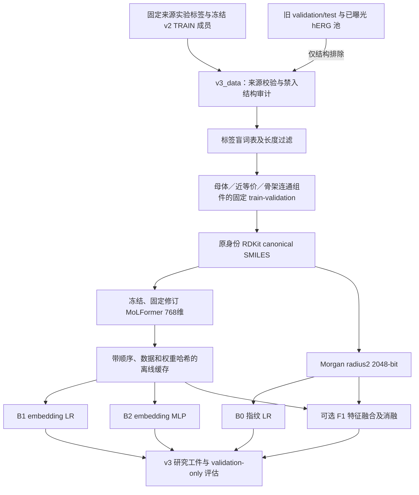

# 蓝研 ToxNet v3：冻结预训练表征开发协议

实施日期：2026-10-13；独立分支 `feat/toxnet-v3-pretraining`。v3 是独立研究链路，未替换正式 v2，也未声明提高盲测或临床泛化性能。实际实验记录见 [TOXNET_V3_EVALUATION.md](TOXNET_V3_EVALUATION.md)，复现命令见 [TOXNET_V3_TRAINING.md](TOXNET_V3_TRAINING.md)。

## 真实项目审查及保留边界

现有 `chemistry.py` 严格解析 canonical isomeric SMILES，保留盐、质子化、同位素与立体信息。`training_data.py` 使用固定 TDC/Harvard 原始文件 SHA256、冲突隔离和 MoleculeNet CT_TOX 核验。`toxnet.py` 是随机初始化的图 Transformer + chirality-aware Morgan 分支，使用缺失标签掩码；`train_toxnet.py` 在 train 优化，在 validation 选择检查点和校准，在 test 评分。

`LocalModelClient` 校验 `aidd.toxnet.artifact.v1`、四端点、真实完成状态、架构、权重/评估/参考结构 SHA256、validation 校准与 test 角色。HTTP 返回模型、规则、参考分数的独立来源。主服务和前端继续使用这个实现。正式模型仍为 `aidd-toxnet-v2-5c22f6cc5dd3`、2,374,390 参数，原模型工件和历史评价只读。

v2 四端点指纹 LR 的 AUROC/AP 均高于神经模型；这项事实保留。hERG_Karim 的 9,978 分子与 v2 AUROC 0.643476 已经曝光，不能重新称为 v3 盲测。旧 validation/test 与该池仅作为排除结构的审计参考，不提供任何 v3 优化、选择或校准标签。

## 实际架构与文件

| 模块 | 实际职责 |
|---|---|
| `backend/v3_data.py` | 新任务契约、真实旧 TRAIN 成员核验、多层身份排除、连通组件划分、许可和哈希复核 |
| `backend/pretrained_encoder.py` | 固定模型、代码/权重核验、冻结本地提取、词表及长度拒绝、缓存一致性 |
| `backend/v3_experiments.py` | B0/B1/B2、固定三种子、train-only 变换、masked MLP、validation 选择、F1 消融 |
| `backend/versioned_local_model.py` | 显式 schema 分派；原 v2 loader 不变；v3 只接受完成并校验的研究工件 |
| `scripts/prepare_v3_data.py` | 不联网造数据、不覆盖已存在输出的开发数据准备入口 |
| `scripts/fetch_pretrained_encoder.py` / `extract_embeddings.py` | 显式固定修订下载/本地导入和冻结向量提取 |
| `scripts/train_toxnet_v3.py` / `predict_toxnet_v3.py` | 独立离线实验及需显式研究许可的推理 |

## P0 数据契约

任务顺序始终为 `herg, dili, ames, clintox`；正类沿用原四来源的定义，ClinTox 是 CT_TOX，不是 FDA_APPROVED。新契约为 `aidd.toxnet.four-real-label-tasks.v3.1`。

只从已验证的原始四端点实验记录重建旧 v2 TRAIN 许可成员。输入分子的完整 canonical 身份不变；审计副本则比较完整结构、去立体/同位素近等价、最大有机片段中和母体、规范互变异构母体，以及完整/母体/互变异构 Bemis–Murcko 骨架。任一关联到禁入集合的整个连通组件都隔离。所有无环结构共享 `[ACYCLIC]`，不会为了满足比例而拆散巨大组。

划分不使用验证性能、禁入标签或按端点强制挑选种子。固定 seed=42、目标 validation 20%，实际数量由连通组件决定。MoLFormer 的词表/202 token 上限作为标签盲预先过滤，B0/B1/B2 使用完全相同的合法分子及划分。缺失任务标签保持不存在并由 mask 屏蔽，不填阴性，不引入模型生成标签。

`load_v3_data` 验证样本、split、audit、排除清单及禁入身份文件的哈希，重新检查成员、标签、原始来源、化学引擎和端点合同。缺少原始源或源字节不同会明确拒绝。source manifest 的时间/路径记录可能让重新准备的数据版本不同；不能仅凭相同文件名复用缓存，要以实际 manifest/split SHA 为准。

真实版本 `aidd-toxnet-v3-development-c1d448002df99aa3`：train 4,243、validation 1,045 分子，共 5,501 条观察标签；2,247 个结构被隔离，最大无环组件 1,409 个完整保留在 train。原 v2 TRAIN 有 7,535 个结构；`audit.oldTrainUniqueStructures=7534` 指词表兼容过滤之后，另一个结构被明确过滤。完整类数与角色审计见评价文档。

Tox21 保留 12 个独立通路，仅做结构角色/交集审计。FDA 两原表只核验来源和版本；没有审核通过的名称到结构映射时，重叠状态是 `not-assessable`，不伪报零交集、不合并 DILI 标签。来源许可仍为 research-only、原始权利与商业再分发未解决；仓库不提交这些原始或派生数据。

## P1 编码器与实验边界

官方 [MoLFormer](https://huggingface.co/ibm-research/MoLFormer-XL-both-10pct) 使用固定修订 `7b12d946c181a37f6012b9dc3b002275de070314`，而非浮动 `main` 或 `compat-v4` 名称。审查详情、逐文件 hashes、许可和执行范围见 [docs/molformer_review.md](docs/molformer_review.md)。运行时无 Auto 动态下载或 `trust_remote_code`；只导入哈希一致的本地审查代码。权重采用 safetensors，冻结 encoder 实际参数 44,375,040，表征维度 768。

原身份 SMILES 经无损 tokenizer 检查；未知 token、非法结构及超过 202 tokens（含 BOS/EOS）明确拒绝，不能截断或静默丢行。盐、同位素、立体身份可以被保留，但上游预训练去掉了 isomeric 信息，这不证明模型学习了这些现象或可靠毒性机制。标准 Morgan 指纹也可能把同位素质量不同的分子映射到相同位向量，B0 不声称具备同位素辨别能力。

B0 固定 C=1 指纹 LR；B1 是 train 标准化后的冻结 embedding LR；B2 是 train 标准化后的 128 维小 MLP。三者用固定 42/43/44 种子和相同划分。MLP 仅用观察标签计算损失，按 validation 宏 AUROC、随后 AP 选择检查点。缺失或单类指标用 `null` 和原因，不造 AUROC/AP。Brier/ECE 仅描述开发 validation 的误差，没有拟合校准器或声称独立校准认证。

F1 将冻结 embedding 与 Morgan 拼接，可单独关闭分支；命令必须同时包含 B0/B1/B2，不能跳过基线。未接入旧 v2 监督图权重；不会混淆随机初始化、v2 监督迁移和无监督预训练。完整 encoder 微调选项目前明确拒绝，必须另立数据、显存、优化和选择协议后才可启用。

## 工件与可用状态

新 schema 是 `aidd.toxnet.artifact.v3`，包含实际 head 参数数、冻结 encoder 参数数、预训练来源/revision/权重和代码哈希、数据版本/manifest/split 哈希、任务合同、种子/依赖/源码哈希、train/validation 用法和真实评价。LR 使用非 pickle 数值 NPZ；MLP 用受限 `torch.load(weights_only=True)`。完成清单在真实权重和评价都持久化后才写入；失败不能产生伪 completed 清单。

`formalAvailability=false`。默认 v3 loader 拒绝研究模型；只有显式 `allow_research=True` 才可加载合法完成的工件，且全部四端点必须实际可训练。未完成、哈希错误、不同编码器、不同 task/schema、CUDA 不可用或缺权重均不能回退成模拟预测。主 HTTP 和正式 v2 供应商没有自动切换。

## Tox21 后续接口衔接

1. 复用 `candidate_data.TOX21_ENDPOINTS` 的 12 个任务名和原始缺失掩码，新增独立的 Tox21 数据契约/来源版本，继续进行 parent/scaffold/已曝光集合审计。
2. 直接复用 `validate_encoder_smiles`、`PretrainedEncoder.encode` 和 `cache_embeddings`；新任务数据 manifest SHA 必须形成独立 cache key。
3. `masked_binary_loss` 已按张量 shape 计算观察任务损失，可用于 12 任务；新增 Tox21 head 或注册明确 `outputDim=12` 架构。现有 `FrozenFeatureMLP`、`label_arrays`、`evaluate_probabilities` 的四任务边界需在新模块中显式参数化，而非悄悄改变 v3 四端点契约。
4. 新 Tox21 schema/loader 输出 12 通路活动分数，不送入四端点 HTTP 响应，不标为临床毒性。FDA 名称映射作为另一个经人工结构审计的来源接口。
